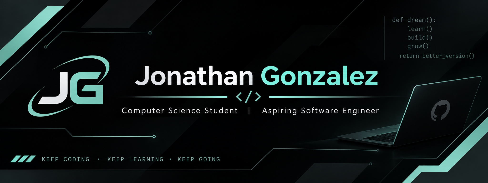

  

# Hi there! I'm Jonathan Gonzalez 👋

### Computer Science Student | Aspiring Software Engineer

I'm a Computer Science student and ¡Supérate! scholarship recipient from Panama, interested in programming, software development and technology.

I enjoy learning by building projects, solving problems and exploring tools that help turn ideas into useful solutions.

- 🎓 Studying Computer Science at Colegio José Guardia Vega.
- 💻 Interested in Python, web development and software engineering.
- 🚀 Project Manager of **Carthy**, a student wellbeing platform developed by a 7-member team.
- 📚 Committed to continuous learning and improving my technical skills.
- 🤝 Open to collaborating on educational and creative technology projects.

---

## 🛠️ Tech Stack

### Programming & Development

### Tools & Technologies

---

## 🚀 Projects

### [Carthy](https://github.com/JonathanG09-I/Carthy)
A student wellbeing platform focused on active listening, emotional support and digital wellness tools for educational communities.

**My role:** Project Manager in a 7-member student team, contributing to project planning, coordination and the development process.

**Technologies:** React, Tailwind CSS, Python, Django and SQLite (during development).

### [Control de Gastos Personales](https://github.com/JonathanG09-I/Control-de-Gastos-Python)
A Python application for recording income and expenses, reviewing transactions, checking monthly summaries and managing budgets.

**Technologies:** Python, CSV and automated tests.

### [Python Learning](https://github.com/JonathanG09-I/Python-Learning)
A beginner-friendly collection of Python exercises covering basic output, user input, variables, conditional statements and arithmetic operations.

**Topics:** Python fundamentals, `print()`, `input()`, data types, `if/elif/else` and mathematical operations.

### [Project Super Extra Jonathan](https://github.com/JonathanG09-I/-ProjectSuperExtra-Jonathan)
A static supermarket-style website showcasing promotions and products through a responsive layout, image carousel and product cards.

**Technologies:** HTML5, CSS3 and Bootstrap 5.3.3.

[Live website](https://jonathang09-i.github.io/-ProjectSuperExtra-Jonathan/)

[Explore all my repositories](https://github.com/JonathanG09-I?tab=repositories).

---

## 📜 Certifications

- **Microsoft Office Specialist (MOS) – Excel Expert**
- **Cisco – Python Essentials 1**

---

## 🏅 Programs & Experiences

- **¡Supérate! Program** — Three years of learning and development in technology, academic skills and personal growth.
- **Hackathon** — Participation in a collaborative technology event focused on developing ideas and solutions.
- **Expo Tech** — Participation in a technology exhibition showcasing projects and technical learning.
- **Expo de Logros** — Participation in an event presenting learning outcomes and projects.

---

## 🌱 Professional Skills

- **Project Coordination** — Planning tasks and supporting the progress of a team project.
- **Teamwork & Collaboration** — Working with others toward shared goals.
- **Problem Solving** — Analyzing challenges and looking for practical solutions.
- **Organization & Responsibility** — Managing tasks and following through on commitments.
- **Continuous Learning** — Staying curious and developing new skills.
- **Communication & Leadership** — Continuously developing through collaborative projects and leadership activities.

---

## 📊 GitHub Activity

  

---

  <i>Always learning. Always building. Always improving.</i>

